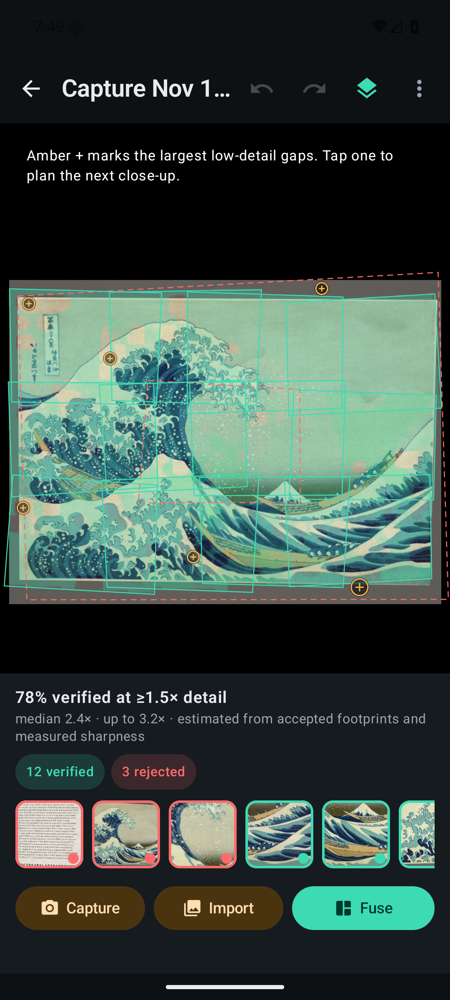
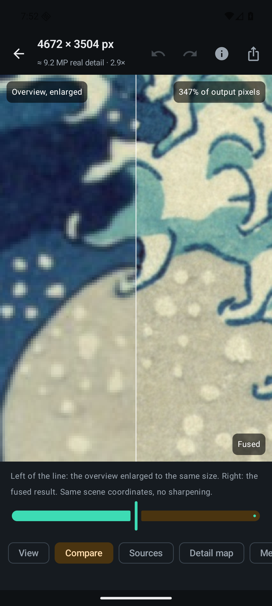
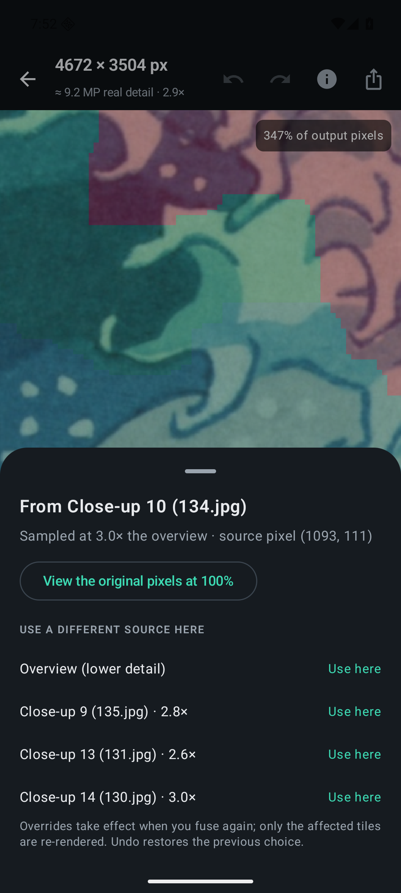

# Detailed Capture

A native Android app that combines **one overview photograph** with **overlapping close-up photographs** of the same
flat subject into a single, deeply zoomable, high-detail image. The close-ups supply the detail: every output pixel
comes from one of your photographs. There is no generative enhancement, no AI up-scaling and no added sharpening;
where no verified close-up exists the result shows the enlarged overview and says so.

<p>
  
</p>

* **Deliverable:** `dist/DetailedCapture-1.0.0.apk` (arm64-v8a + x86_64, minSdk 26, targets Android 16 / API 36).
* **Everything on-device:** no account, no network permission, no cloud, no keys. No desktop companion is needed:
  results are rendered tile by tile (out-of-core), so memory does not grow with output size. A 401 MP result from
  eight photographs of 9.5–24 MP was fused on the 2 GB-RAM Android emulator (docs/DEVICE_VERIFICATION.md).
* **Core:** C++17 + OpenCV 4.12 (`core/`), shared by the app and by the Linux evaluation tools, so the measured
  results come from exactly the code the phone runs.

## What you do in the app

1. **New project** → take or import the overview.
2. On the **capture map** tap an area, then **Capture** (camera with focus/exposure lock, EV, lens choice, live
   placement on a mini-map, blur/exposure warnings, optional auto-capture, RAW+JPEG where the device offers it) or
   **Import** close-ups from the photo picker (or share photos into the app).
3. Every close-up is checked in the background and becomes **Verified**, **Uncertain** or **Rejected** with a
   plain-language reason. The map shows accepted footprints, the estimated detail gain, and the largest gaps.
4. **Fuse** → real stage progress, cancellable, resumable, the previous result stays valid until the new one is
   committed.
5. **View**: pinch-zoom tiled viewer, split-screen **Compare** with the enlarged overview at matched scene
   coordinates, **Sources** overlay (tap anywhere → which photo, open its original pixels at 100 %, or choose a
   different source there), **Detail map**, **Measure** (pixels, or real units after you give a reference length),
   **Crop / Rotate / Perspective / Colour** edits with undo/redo.
6. **Export**: PNG, TIFF, JPEG, a Deep-Zoom tile package with an offline viewer, or a portable project archive;
   then Share or Save as.

Capture advice: [docs/CAPTURE_GUIDE.md](docs/CAPTURE_GUIDE.md).

## Install the APK

```bash
adb install -r dist/DetailedCapture-1.0.0.apk
adb shell am start -n com.detailedcapture.app/.MainActivity
```

The APK is a shrunk release build signed with the standard Android debug key (no private keystore is needed to
reproduce it); enable "install unknown apps" when side-loading by hand.

## Build from source (Linux)

Prerequisites: JDK 17, Android SDK with `platforms;android-36`, `build-tools;36.0.0`, `ndk;27.1.12297006`,
`cmake;3.22.1` (set `ANDROID_HOME`), plus `cmake`, `ninja`, a C++17 compiler, `curl`, `unzip` for the host tools.
Internet is needed only for the one-time dependency download.

```bash
scripts/fetch_deps.sh                       # OpenCV 4.12.0 Android SDK + sources (≈ 390 MB download)
echo "sdk.dir=$ANDROID_HOME" > android/local.properties
(cd android && ./gradlew :app:assembleRelease)      # → android/app/build/outputs/apk/release/app-release.apk
```

Host tools (CLI, tests, evaluation):

```bash
scripts/build_opencv_host.sh                # minimal static OpenCV for Linux (≈ 5 min)
cmake -S core -B build/core -G Ninja -DCMAKE_BUILD_TYPE=Release && cmake --build build/core
build/core/dcore_tests                      # 9 deterministic tests
uv venv .venv --python 3.12 && uv pip install --python .venv/bin/python -r eval/requirements.txt
.venv/bin/python eval/gen_synthetic.py datasets/synthetic/sets     # render the synthetic capture sets
.venv/bin/python eval/run_all.py && .venv/bin/python eval/run_real.py && .venv/bin/python eval/make_report.py
```

Run the pipeline on any folder containing `overview.*` and `closeup_*.*`:

```bash
.venv/bin/python eval/dcrun.py <folder> <project_dir>          # add → register → coverage → fuse
build/core/dcap export.flat '{"dir":"<project_dir>","format":"png","path":"out.png"}'
build/core/dcap export.tiles '{"dir":"<project_dir>","outDir":"out_tiles","format":"png"}'   # open out_tiles/viewer.html
```

Emulator (headless) with a project-local AVD: see [docs/DEVICE_VERIFICATION.md](docs/DEVICE_VERIFICATION.md).

## Results in brief

Measured numbers, tables and method: **[docs/EVALUATION.md](docs/EVALUATION.md)** (generated from
`eval/results/summary.json`). Example inputs are in `datasets/`, actual outputs (previews, matched crops, reports)
in `eval/results/`.

## Repository layout

| Path | Content |
|---|---|
| `android/` | the app (Kotlin, Compose, CameraX, JNI bridge) |
| `core/` | C++ core, `dcap` CLI, `dcore_tests` |
| `eval/` | synthetic capture simulator, runner, scoring, report generator; `eval/results/` holds measured outputs |
| `datasets/synthetic/` | ground-truth sources and rendered capture sets |
| `datasets/real/` | four licensed real overview + close-up sets (`SOURCES.md`) |
| `docs/` | architecture & limits, formats, capture guide, evaluation, device verification, independent review |
| `scripts/` | dependency fetch, host OpenCV build, adb UI helpers |
| `dist/` | the installable APK |
| `LICENSES.md` | dependencies, data sources, licences, versions |

## Honest limits

* Flat, static, textured subjects only. Depth/parallax, reflections, movement and lighting changes are not
  "fixed" and there is no 3-D mode. Photos or parts of photos that disagree with a flat subject are masked,
  marked uncertain or rejected with an explanation — but this detection works cell by cell at the overview's
  resolution and is not perfect: on a 3-D subject, small displaced parts can remain inside a "Verified" photo.
  The project screen warns when a subject looks non-planar; treat such results with suspicion.
* A photo is "Verified" when it aligns to the overview within about 1.5 overview pixels. At 5× that is still up
  to several output pixels, so fine edges can show a small step where one photo ends and the next begins, and
  sharpness changes abruptly where close-up coverage ends (also in the middle of an object).
* Repeating patterns and blank areas cannot be placed uniquely without a landmark; such frames are marked
  uncertain (never guessed) and can be placed manually.
* Lost focus, motion blur, noise and clipped highlights cannot be recovered by combining photos.
* 8 bits per channel throughout; JPEG export is limited to 65 535 px per side (other formats are not).
* Output size is not detail. The app reports estimated genuine detail separately from pixel dimensions.
* Detail is not certified measurement accuracy; real-world units require an explicit reference and come with a
  stated uncertainty.
* Verified on an Android 16 emulator with imported photographs and the emulated camera. **No physical device was
  available**: real camera behaviour (focus/exposure lock, RAW, auto-capture steadiness, thermal behaviour, speed)
  is implemented but unverified — see [docs/DEVICE_VERIFICATION.md](docs/DEVICE_VERIFICATION.md).

More: [docs/ARCHITECTURE.md](docs/ARCHITECTURE.md) · [docs/FORMATS_AND_LIMITS.md](docs/FORMATS_AND_LIMITS.md) ·
[docs/REVIEW.md](docs/REVIEW.md) · [LICENSES.md](LICENSES.md)
